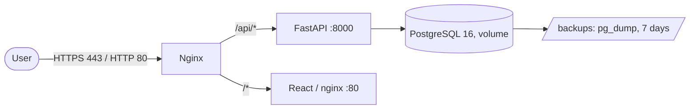

# 🏗 RTK CRM architecture

English version of [../../architecture/ARCHITECTURE.md](../../architecture/ARCHITECTURE.md).

## System overview

RTK CRM is a B2B CRM system for Rostelecom managers who drive interaction with universities. The
system implements the full cycle of a 14-stage workflow.

## Diagrams

- **C4 Level 1** — [System Context](c4-context.md)
- **C4 Level 2** — [Containers / Components](c4-components.md)
- **Functional architecture** — [the user path and the services](functional.md)
- **Data model (ER)** — [entities and relationships](er-model.md)

### Models in Archi (ArchiMate 3)

Requirement 6.7 of the specification asks for a functional and a component architecture in Archi.
The models open in [Archi](https://www.archimatetool.com/) for free.

- **Functional** — [`functional.archimate`](../../architecture/functional.archimate): the 5-step user path
  (authorization → browsing → filtering → status update → report) and the supporting services.
  [PDF version](../../architecture/functional.pdf).
- **Component** — [`rtk-crm.archimate`](../../architecture/rtk-crm.archimate): containers, external systems and the
  target deployment.
- **Data model (ER)** — [`er.archimate`](../../architecture/er.archimate): 14 entities and the `ON DELETE` rules.
  [PDF version](../../architecture/er-model.pdf).
- **Deployment** — [current](deployment-current.md) and [in Yandex Cloud](deployment-yandex-cloud.md)

The diagrams are written in Mermaid and render directly on GitHub/GitLab, so they need no separate
PDF export for review. The presentation version is assembled from the same sources.

## Component diagram

```
┌─────────────────────────────────────────────────────────────┐
│                        Client Layer                         │
│  ┌─────────────┐  ┌─────────────┐  ┌─────────────┐         │
│  │   Browser   │  │   Mobile    │  │   Admin     │         │
│  │   (React)   │  │   App       │  │   Panel     │         │
│  └──────┬──────┘  └──────┬──────┘  └──────┬──────┘         │
└─────────┼────────────────┼────────────────┼────────────────┘
          │                │                │
          └────────────────┼────────────────┘
                           │ HTTPS (443)
                    ┌──────▼──────┐
                    │   Nginx     │  ← Reverse Proxy, SSL, Static
                    └──────┬──────┘
                           │
          ┌────────────────┼────────────────┐
          │                │                │
   ┌──────▼──────┐  ┌──────▼──────┐  ┌──────▼──────┐
   │  Frontend   │  │   Backend   │  │   Keycloak  │
   │  (Port 3000)│  │  (Port 8000)│  │  (Port 8080)│
   │   React     │  │   FastAPI   │  │   OAuth2    │
   └─────────────┘  └──────┬──────┘  └─────────────┘
                           │
                ┌──────────┼──────────┐
                │          │          │
         ┌──────▼───┐  ┌──▼────┐  ┌──▼──────┐
         │ Postgres │  │ Redis │  │  Files  │
         │  (5432)  │  │(6379) │  │ Storage │
         └──────────┘  └───────┘  └─────────┘
```

## Technology stack and the rationale

The full dependency versions are in [`../STACK.md`](../STACK.md).

### Backend
- **Language**: Python 3.11
- **Framework**: FastAPI 0.141
- **ORM**: SQLAlchemy 2.0 (AsyncIO)
- **Validation**: Pydantic v2
- **Migrations**: Alembic
- **Authentication**: python-jose, passlib

### Frontend
- **Framework**: React 18
- **Language**: TypeScript 5.x
- **Build**: Vite 7
- **UI Kit**: Ant Design
- **HTTP client**: Axios

### Databases
- **Main**: PostgreSQL 16 (ACID, JSONB, full-text search)
- **Cache**: Redis 7 → KeyDB as the load grows (see "Scalability")

### Infrastructure
- **Containerisation**: Docker, Docker Compose
- **Web Server**: Nginx (Alpine) — the Yandex Cloud target contour
- **Auth**: JWT (HS256) + bcrypt; Keycloak is an option for the target contour

### Why this particular stack

| Component | Choice | Why not the alternative |
|---|---|---|
| Backend | Python + FastAPI | The specification itself suggests Python/Postgres; FastAPI provides asynchronous I/O for a load of 300+, OpenAPI generation and a shared type language with Pydantic. Kotlin/Node would demand a separate team and a rewrite with no gain for CRM tasks |
| Frontend | React + Ant Design | Ant Design covers the Kanban board, tables, forms and filters out of the box — on a prototype that saves weeks of layout work; React was chosen for the dnd-kit ecosystem (stage drag-and-drop) and Recharts (report charts) |
| Database | PostgreSQL | A relational model with transactions suits the workflow and the audit (152-FZ); SQLite is used only in tests and local runs |
| Cache | Redis/KeyDB | Reports aggregate many rows; a 30-second cache removes the load. KeyDB is a multi-threaded fork of Redis with the same protocol, so the move needs no code changes |
| Authentication | JWT now, Keycloak as groundwork | For the prototype JWT needs no separate service; the code keeps the path to corporate Keycloak should the customer require SSO |

The only non-standard decision is dropping workflow versioning (a direct requirement from the
Q&A: "changes apply to everyone at once"), so the model has no version table and moving tasks
when a stage is deleted is built into the service.

## Backend modular architecture

```
backend/
├── main.py                  # Entry point, middleware, health probes
│
├── api/                     # REST routers (the /api prefix)
│   ├── auth.py              # Sign-in, users
│   ├── interactions.py      # Cards, board, tasks, comments, summary
│   ├── universities.py      # Universities
│   ├── directories.py       # Directions and products
│   ├── catalogs.py          # Import of XLS/XLSX/JSON
│   ├── stages.py            # Workflow stages, deletion consequences
│   ├── files.py             # File upload and download
│   ├── reports.py           # Reports and export
│   ├── audit.py             # Action log (152-FZ)
│   ├── notifications.py     # Stalled requests
│   ├── integration.py       # Exchange with external systems
│   └── access.py            # Access checks for interactions
│
├── auth/
│   ├── security.py          # JWT, passwords, get_current_user, RBAC
│   └── keycloak.py          # JWKS RS256 validation (AUTH_MODE=keycloak)
│
├── core/config.py           # Settings (pydantic-settings)
├── db/                      # Database connection, base class, sessions
├── middleware/audit.py      # Automatic recording of changes into ActionLog
│
├── models/                  # SQLAlchemy models and enums
│   ├── entities.py          # University, Interaction, Action, Comment, User, ActionLog
│   └── enums.py             # Roles, the B2B/B2C scope
│
├── schemas/entities.py      # Pydantic schemas (DTO)
│
└── services/                # Business logic
    ├── excel_import.py      # Parsing XLS/XLSX/JSON
    ├── import_report.py     # The import report
    ├── excel_export.py      # Report export
    ├── report_columns.py    # The report column set
    ├── report_cache.py      # Report cache (Redis/KeyDB)
    ├── file_storage.py      # S3/MinIO with a local fallback
    ├── notifications.py     # Finding stalled requests
    ├── scheduler.py         # Periodic tasks
    ├── integration.py       # External systems (LMS)
    ├── guide_pdf.py         # PDF guides
    └── gigachat.py          # Card summary (FT-6)
```

## Database schema

The full ER diagram with fields, relationships and integrity rules is in
[`er-model.md`](er-model.md). In brief:

| Table | Purpose |
|---|---|
| `users` | Users and roles (user / manager / admin) |
| `universities` | Universities and contact persons |
| `it_directions`, `it_products` | Reference data for directions and products |
| `workflow_stages` | Funnel stages, separated by the `scope` field (b2b / b2c) |
| `interactions` | Interaction cards: university + product + stage + contract |
| `actions`, `comments`, `attached_files` | The card's tasks, comments and files |
| `action_logs` | The action log for the audit (152-FZ) |

The key difference from earlier versions: the stage and the contract belong to the
**interaction** (`interactions`), not to the university directly — one university can run several
parallel interactions (no more than two active, as the Q&A requires).

## Security and 152-FZ

### RBAC (Role-Based Access Control)

| Role | Rights |
|------|-------|
| **User** | Reading universities, comments |
| **Manager** | CRUD on universities, file uploads, moving through the workflow |
| **Admin** | Full access, user management, logs |

### Logging (FSTEC)

All actions are recorded in `action_logs`:
- Who (user, ip_address)
- What was done (action, old_value, new_value)
- When (created_at)
- With what (university_id)

### Authentication

Two modes, switched by `AUTH_MODE`:

- **`jwt`** (the default) — JWT Bearer tokens (HS256), passwords — bcrypt. The roles
  `user` / `manager` / `admin` are checked locally.
- **`keycloak`** — tokens are signed by Keycloak (RS256), the CRM verifies the signature against
  the realm's public keys (JWKS), then `iss`, `aud` and the expiry. Roles are taken from
  `realm_access.roles` and synchronised with the local account at sign-in. The design and the
  configuration procedure are in `docs/KEYCLOAK.md`.

HTTPS is mandatory in both modes. The card summary sends data to the external GigaChat service
only after an access check (see `docs/AI.md`).

### AI in the workflow

The specification allows AI inside the workflow (FT-6). In the system this is a single feature —
the interaction card summary: a KAM opens the card and gets a short text about the current stage,
what has been done and the next step.

| Aspect | Decision |
| --- | --- |
| Model | GigaChat, Sber's closed contour |
| Data in the prompt | Only names (university, product, stage), comment texts and service fields |
| Personal data | Not transferred: not stored in the card, dropped at import |
| Compliance | 152-FZ: processing happens in Russia, the data does not leave the contour |
| Transport | HTTPS, verified against the Ministry of Digital Development CA root certificate |
| Service failure | Does not break the card: 502 with the demo mode off, a deterministic summary from the card data with it on |

The demo summary is marked with a separate model name `demo summary (GigaChat was not called)`, so
it cannot be mistaken for a model answer. The design and configuration are in `docs/AI.md`, the
security requirements in `docs/SECURITY.md`.

## API Endpoints

The full schema is in the Swagger UI (`/docs`). Below are the routes the application actually
registers; all carry the `/api` prefix except the service probes.

### Authentication and users
- `POST /api/auth/login` — sign-in, issuing a JWT
- `GET /api/auth/me` — the current user
- `GET|POST /api/auth/users` — listing and creating users
- `PATCH|DELETE /api/auth/users/{user_id}` — updating and deleting

### Interactions
- `GET|POST /api/interactions` — the filtered list and creation
- `GET /api/interactions/board` — the Kanban board data
- `GET|PATCH|DELETE /api/interactions/{interaction_id}` — the card
- `POST /api/interactions/{interaction_id}/move` — a stage change
- `GET|POST /api/interactions/{interaction_id}/actions` — tasks
- `PATCH|DELETE /api/interactions/actions/{action_id}`
- `GET|POST /api/interactions/{interaction_id}/comments` — comments
- `DELETE /api/interactions/comments/{comment_id}`
- `POST /api/interactions/{interaction_id}/summary` — the GigaChat summary (FT-6)

### Reference data and import
- `GET|POST /api/universities`, `GET|PATCH|DELETE /api/universities/{university_id}`
- `GET|POST /api/directions`, `DELETE /api/directions/{direction_id}`
- `GET|POST /api/products`, `DELETE /api/products/{product_id}`
- `POST /api/catalogs/import/preview` and `/execute` — XLS/XLSX import
- `POST /api/catalogs/import/json/preview` and `/execute` — JSON import
- `POST /api/catalogs/import/report` — the import report

### Workflow stages
- `GET|POST /api/stages`, `POST /api/stages/reorder`
- `PATCH|DELETE /api/stages/{stage_id}`
- `GET /api/stages/{stage_id}/impact` — the consequences of deleting a stage

### Files
- `GET /api/files/interactions/{interaction_id}` — the card's files
- `POST /api/files/interactions/{interaction_id}/upload`
- `GET /api/files/{file_id}/download`, `DELETE /api/files/{file_id}`

### Reports and audit
- `GET /api/reports`, `/columns`, `/preview`, `/universities`
- `GET /api/reports/xlsx`, `/xls`, `/pdf`, `/json`
- `GET /api/audit`, `/entity-types`, `/export`

### Notifications and integration
- `GET /api/notifications/stuck`, `POST /api/notifications/stuck/dispatch`
- `GET /api/integration/schema`, `POST /api/integration/preview` and `/import`
- `GET /api/integration/outbound`, `GET /api/integration/pull/{source}`

### Service
- `GET /healthz` — liveness, `GET /readyz` — readiness (database, cache, S3)
- `GET /metrics` — Prometheus metrics

GigaChat is deliberately not checked in `/readyz`: the feature is optional, and its unavailability
must not put the service into a degraded state.

## Scalability

The target load is **300+ simultaneous users** of the IT School: managers work with the board and
cards all day, administrators load reference data and view reports in parallel. Below is what lets
the system hold this profile and what changes as it grows further.

### What is already in the code

| Mechanism | Where | Why it matters at 300+ |
|---|---|---|
| A fully asynchronous stack (FastAPI + SQLAlchemy AsyncIO + asyncpg) | `backend/main.py`, `backend/db/session.py` | Waiting on database I/O does not block the worker: one process serves hundreds of connections |
| `NullPool` for connections | `backend/db/session.py` | Compatible with an external pooler (pgbouncer in Yandex Managed PostgreSQL, the Supabase pooler): connections do not "stick" in the process |
| The report cache in Redis/KeyDB, TTL 30 s | `backend/services/report_cache.py` | Heavy aggregates are not computed on every request — this removes load from PostgreSQL |
| Login rate limiting (5 attempts / 60 s per IP) | `backend/middleware/rate_limit.py` | Protection against password brute force and against a burst of 401s during scanning |
| Indexes on foreign keys and dates | `backend/alembic/versions/` | Board and report filters by stage/date do not degrade as the data grows |
| Background tasks in a single instance (`max_instances=1`) | `backend/services/scheduler.py` | The stalled-request check does not multiply with several replicas |

`/healthz` (liveness) and `/readyz` (readiness, checks the database) are separated
(`backend/main.py`): the balancer diverts traffic from an instance that lost its database but does
not restart it because of a short-lived dependency failure.

### Horizontal scaling

- **Backend**: several replicas behind a balancer (Docker Swarm / Kubernetes). The application is
  stateless: sessions live in the JWT, the cache in Redis/KeyDB, files in S3/MinIO.
- **Cache**: Redis is replaced with **KeyDB** — a multi-threaded fork with the same protocol and
  the `redis-py` client. The reason: Redis is single-threaded, and at 300+ users one thread hits
  the CPU limit before the memory limit. KeyDB uses all the cores without code changes — it is
  enough to change the image in `docker-compose.yml`.
- **Database**: PostgreSQL with a read replica for reports (master — writes, replica — heavy
  dashboard `SELECT`s).
- **Files**: MinIO/S3 is moved outside the backend pod; the local disk is used only as a
  development fallback (`backend/services/file_storage.py`).

### When it is time to change the configuration

| Symptom | Action |
|---|---|
| Backend CPU > 70% | Add backend replicas (horizontally) |
| Cache hit rate is high but latency grows | Move to KeyDB, increase the cache memory |
| Reports compete with writes | Move reads to a PostgreSQL replica |
| A growing number of background notifications | Move the scheduler into a separate worker |

### Query optimisation

- Indexes on frequently used fields (stage, product, creation date, foreign keys).
- Caching of report aggregates (Redis/KeyDB, TTL 30 s), invalidation on mutation.
- Asynchronous I/O operations (`asyncpg`, `aiofiles`).

## Monitoring and logging

- Health checks: `/healthz` (liveness), `/readyz` (readiness + database), `/api/health` (the
  extended status), `/health` (a short alias for external platforms and health checks).
- Logs: stdout/stderr (Docker logs), structured through `loguru`.
- Metrics: `prometheus-fastapi-instrumentator` on `/metrics`.

## Deployment

### Production checklist

- [ ] Replace SECRET_KEY with a random string
- [ ] Configure HTTPS certificates
- [ ] Enable PostgreSQL backups
- [ ] Set up monitoring
- [ ] Restrict access to the admin area
- [ ] Enable rate limiting

## Contacts

Development team: RTK CRM, Rostov-on-Don (met while studying at RKSI)
E-mail: team@rtk-crm.ru
Hackathon: "Leaders of Digital Transformation 2026"
Case 6: Rostelecom IT School

## Migration plan to Yandex Cloud

### Rationale

The contour currently sits outside Russia: Render (backend), Vercel (frontend), Supabase
(PostgreSQL, the us-west-2 region). The requirements of Federal Law 152-FZ "On Personal Data" on
the localisation of databases of Russian citizens and FSTEC order No. 117 assume placement in the
Russian jurisdiction. Yandex Cloud provides certified infrastructure and is migrated without code
changes — the whole stack is already containerised. The external contour remains working and is
used as the public demonstration stand.

The infrastructure for the move is prepared and verified: the whole stack was built and brought
up, and sign-in through nginx worked. Switching production over is done through a DNS change and
requires a decision from the system owner.

### Diagram



Everything runs on a single Ubuntu 22.04/24.04 VM (2 vCPU, 4 GB RAM, 30 GB disk).

### Two nginx modes

The config template is chosen at container start by `TLS_ENABLED`:

| `TLS_ENABLED` | What comes up | Purpose |
|---|---|---|
| `false` | port 80 only, answering by IP | debugging while there is no domain or certificate |
| `true` | 80 (redirect) + 443 with a certificate | the demonstration to the jury |

The split is needed because with TLS nginx does not start without the files
`/etc/letsencrypt/live/$DOMAIN/fullchain.pem` — without this mode debugging the stack by IP would
be impossible.

### Step-by-step plan

1. Create the VM and a static public IP.
2. Run `infra/yandex-cloud/setup-vm.sh` (Docker, certbot, ufw, swap, the cron backup, cloning the
   repository).
3. Fill in `.env` following the `infra/yandex-cloud/.env.prod.example` template.
4. Bring the stack up with `TLS_ENABLED=false` and check `/api/health`.
5. Point the domain's A record at the IP, issue a Let's Encrypt certificate, switch
   `TLS_ENABLED=true`.
6. Move the data from the external database: `pg_dump` → `pg_restore` into the `rtk_postgres`
   container.
7. Check `https://crm-rtk.pixel-minds.ru/api/health`, then switch DNS to the VM IP.

Details and commands — in `infra/yandex-cloud/README.md`.

### What moves automatically and what by hand

| Automatically (`docker compose`) | By hand |
|---|---|
| Building and starting the backend, the frontend, nginx | Creating the VM and the static IP |
| The database schema (created by the application at start-up) | Moving the data (`pg_dump` / `pg_restore`) |
| Choosing the nginx config by `TLS_ENABLED` | The domain's A record and issuing the certificate |
| Daily backups (cron + `backup.sh`) | Filling in the secrets in `.env` |

### Cost estimate

Compute resources 748.80 ₽ + 4 GB RAM 950.40 ₽ + a 30 GB disk 103.68 ₽ + a public IP 189.73 ₽ =
**1 992.61 ₽ per month**. A 5 000 ₽ grant covers about 2.5 months of continuous operation.

### Backward compatibility

The base `docker-compose.yml` was not changed; the Yandex variant lives in separate files
(`docker-compose.prod.yml` in the root is an overlay with a local Postgres,
`infra/yandex-cloud/docker-compose.prod.yml` is the full production stack with nginx). A local run
through the Vite proxy is not affected either: `VITE_API_URL` is empty by default, so requests go
to the page's own origin.
