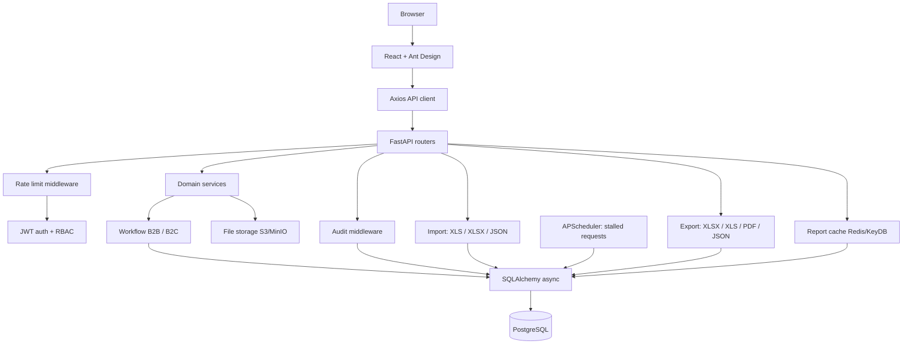

# C4 Components

English version of [../../architecture/c4-components.md](../../architecture/c4-components.md).

The frontend is responsible for presentation and interactions, the backend for authorization,
validation, business rules, audit and data access. The report aggregate cache and the
notification scheduler are separate services so that request processing is never blocked.
