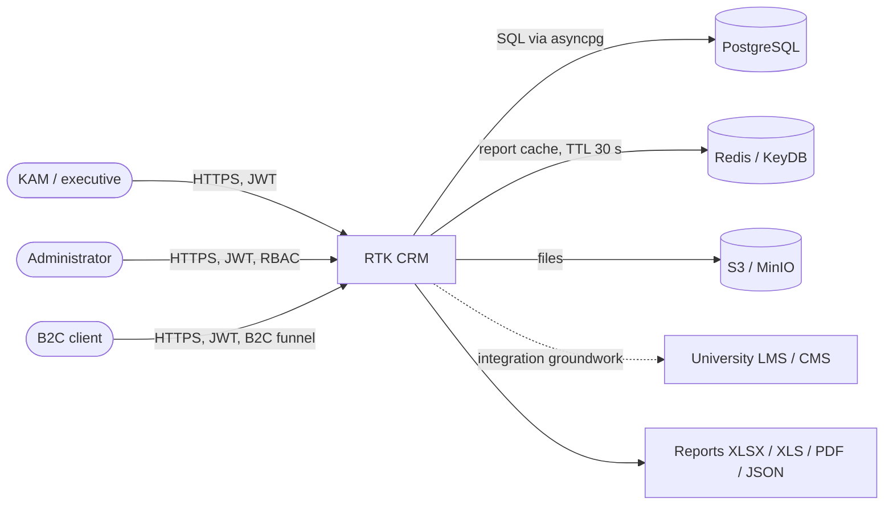

# C4 Context

English version of [../../architecture/c4-context.md](../../architecture/c4-context.md).

The system accepts user actions, runs two independent workflows (B2B — 14 stages of the IT
School, B2C — a simplified funnel), stores working data in PostgreSQL, caches report
aggregates and produces exports in four formats.
