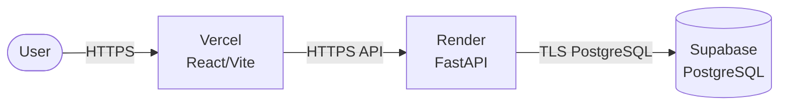

# External contour (Render + Vercel + Supabase)

English version of [../../architecture/deployment-current.md](../../architecture/deployment-current.md).

Vercel publishes the static frontend. Render serves the API. Supabase provides
PostgreSQL. The backend CORS policy restricts the allowed origins.

This contour needs no infrastructure of its own and is used as a public demo stand. The
main contour is Yandex Cloud (see [deployment-yandex-cloud.md](deployment-yandex-cloud.md)).
