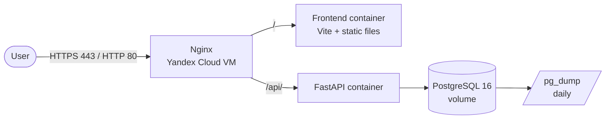

# Deployment in Yandex Cloud

English version of [../../architecture/deployment-yandex-cloud.md](../../architecture/deployment-yandex-cloud.md).

## Diagram

All containers share one docker network. Only nginx is exposed: the backend and the database
are unreachable from outside.

## Components

| Component | Implementation | Where it is described |
|---|---|---|
| VM | Ubuntu 22.04/24.04, 2 vCPU, 4 GB RAM | `infra/yandex-cloud/README.md` |
| nginx | `nginx:1.27-alpine`, config templates | `infra/yandex-cloud/nginx-*.conf.template` |
| Backend | FastAPI + uvicorn in a container | `backend/Dockerfile` |
| Frontend | a Vite build served by nginx | `frontend/Dockerfile` |
| Database | PostgreSQL 16 in a container | `docker-compose.prod.yml` |
| TLS | Let's Encrypt through certbot | `infra/yandex-cloud/README.md` |

## Two operating modes

The mode is set by `TLS_ENABLED` in `.env`, the nginx template is chosen when the container
starts (`nginx-entrypoint.sh`):

- `TLS_ENABLED=false` — port 80 only, answering by IP. Needed for debugging when there is no
  domain or certificate yet: with TLS nginx does not start without
  `/etc/letsencrypt/live/$DOMAIN/fullchain.pem`.
- `TLS_ENABLED=true` — 80 (redirect to HTTPS) and 443 with a certificate.

## One origin instead of two

In the previous contour the frontend (Vercel) and the backend (Render) lived on different
domains, so every request was cross-origin and needed a correct CORS allowlist. After the
move, both the frontend and the API are served by one nginx: requests go to the same origin
and the `/api/` path is proxied to the backend. `VITE_API_URL` stays empty at build time — if
an absolute address is set, the browser goes to the backend past nginx and gets a CORS
rejection.

## Data placement and 152-FZ

The VM in Yandex Cloud sits in the Russian jurisdiction, which satisfies the requirements of
Federal Law 152-FZ on storing personal data. The demo data is anonymised
(`SEED_DEMO_DATA=true`).

## What a migration requires

1. Create a VM with a static public IP.
2. Run `setup-vm.sh` (Docker, swap, ufw, repository clone).
3. Fill in `.env` following `infra/yandex-cloud/.env.prod.example`.
4. Bring the stack up with `TLS_ENABLED=false` and check `/api/health`.
5. For a domain: A records pointing to the VM IP, `certbot certonly --standalone`, then
   `TLS_ENABLED=true`.
6. Move the data: `pg_dump` → `pg_restore` into the `rtk_postgres` container.
7. Switch DNS.
