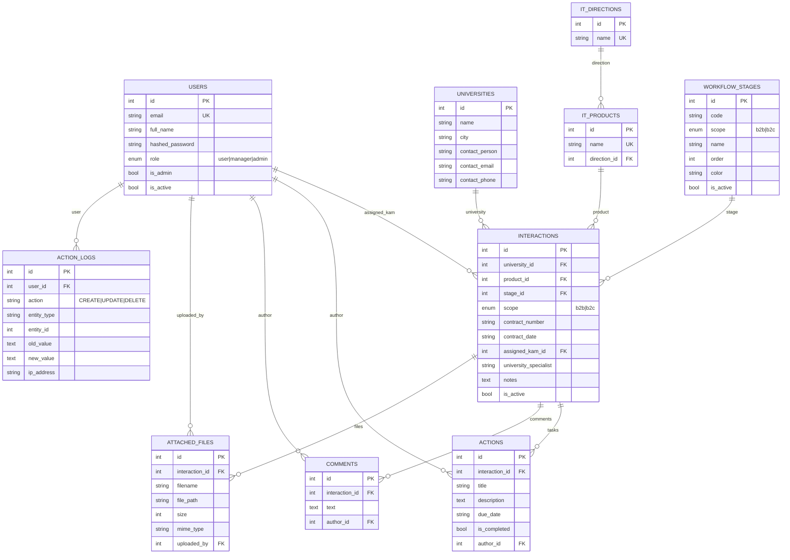

# Data model (ER)

English version of [../../architecture/er-model.md](../../architecture/er-model.md).
The ER diagram follows the actual SQLAlchemy models (`backend/models/entities.py`). It can be
exported to PNG/PDF with GitHub's renderer or the Mermaid CLI; the source is versioned with
the code.

Ready artefacts sit next to this file: [`er.mmd`](../../architecture/er.mmd) — the extracted Mermaid source,
[`er-model.pdf`](../../architecture/er-model.pdf) — the rendered diagram, [`er.archimate`](../../architecture/er.archimate) — the
same schema in ArchiMate 3 for Archi. Rebuild:
`python scripts/extract_er_diagram.py`, then `mmdc -i er.mmd -o er-model.pdf`.

## Integrity rules

| Relationship | On delete | Meaning |
|---|---|---|
| `interactions.university_id → universities.id` | `CASCADE` | A university with interaction history is not deleted in isolation — the history goes with it |
| `interactions.product_id → it_products.id` | `SET NULL` | Deleting a product does not break the card |
| `interactions.stage_id → workflow_stages.id` | `RESTRICT` | An active stage cannot be deleted while it holds cards — move the tasks first |
| `interactions.assigned_kam_id → users.id` | `SET NULL` | An employee leaving does not delete the requests |
| `actions/ comments / attached_files .interaction_id` | `CASCADE` | Child records live only inside the card |
| `*_logs.user_id → users.id` | `SET NULL` | Audit records survive the deletion of a user |

## Indexing

Indexes cover the foreign keys and filter columns (`interactions.university_id`,
`interactions.stage_id`, `action_logs.user_id`) and the frequently filtered strings
(`universities.name`). This keeps board filtering and report building acceptable at the
target load of 300+.

## B2B and B2C workflows

The two stage sets differ by `workflow_stages.scope`: `WORKFLOW_STAGES` (the 14 stages of the
IT School) for B2B and `B2C_STAGES` (a simplified funnel "request → payment → training →
completed") for B2C. There is no versioning: a stage change applies to all active requests at
once.
