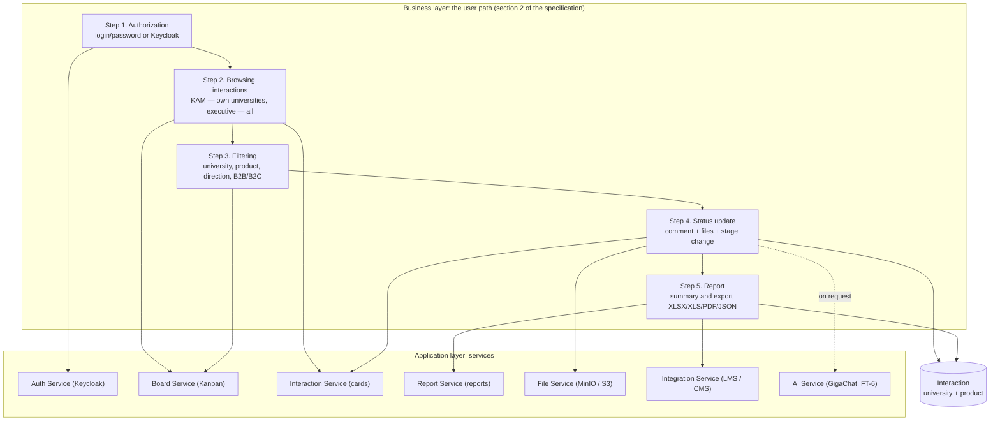
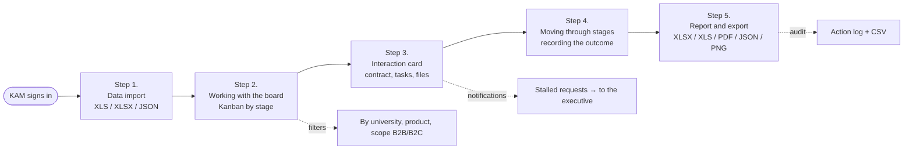
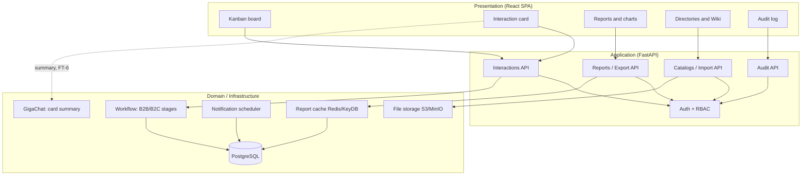

# Functional architecture

English version of [../../architecture/functional.md](../../architecture/functional.md).
The diagram shows the KAM user path (5 steps: authorization, browsing, filtering, status
update, report) and the backend services that serve it. The Mermaid diagram renders on
GitHub/GitLab; when needed it is exported to PNG/PDF for a presentation.

The same model in ArchiMate 3 is [`functional.archimate`](../../architecture/functional.archimate) (opens in
[Archi](https://www.archimatetool.com/)), with a ready [PDF version](../../architecture/functional.pdf). The
Mermaid source for rendering is [`functional.mmd`](../../architecture/functional.mmd).

## The user path and the services in Archi

## Operating cycle: import → board → card → report

## Operations and supporting services

| Cycle stage | Screen | Backend service | Key entities |
|---|---|---|---|
| 1. Data import | `DirectoryPage` | `services/excel_import.py`, `services/import_report.py` | `University`, `ITProduct`, `Interaction` |
| 2. Board | `BoardPage` | `api/interactions.py` (list, board) | `Interaction`, `WorkflowStageRef` |
| 3. Card | `InteractionDrawer` | `api/interactions.py`, `api/files.py` | `Action`, `Comment`, `FileObject` |
| 4. Stage change | board / card | `api/interactions.py` (stage update) | `Interaction.stage_id` |
| 5. Reports and export | `ReportPage`, `AuditLogPage` | `api/reports.py`, `api/audit.py`, `services/excel_export.py` | `ActionLog`, aggregates |

## Functional blocks

The key business logic is a single workflow without versions: a stage change applies
immediately to all active requests, and deleting a stage moves the tasks to a neighbouring
one so that work never stops.

GigaChat is called only on an explicit user request from the card and takes no part in the
main scenario: without a key the "Summary" tab reports that the service is not configured.
Details — `docs/AI.md`.
